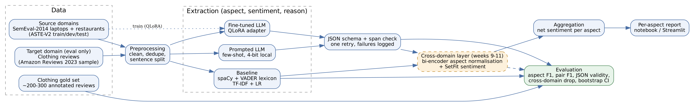

# Cross-Domain Aspect-Based Review Analysis with a Fine-Tuned Open-Source LLM

Capstone (CS5998), R.M.D.S. Rathnayake, 268486N.

Pipeline: review, extraction (baseline / prompted LLM / QLoRA fine-tuned LLM), aspect normalisation, sentiment, aggregation into a per-aspect report.
Only open-source models run locally in 4-bit; no external LLM APIs are used.



## Milestone 2 status

| Item | Status | Where |
|---|---|---|
| Data preprocessing | Done for both source domains and the clothing target | `src/prepare_data.py`, `src/prepare_clothing.py` |
| Exploratory data analysis | Done | `notebooks/01_eda.ipynb`, `results/eda/` |
| Baseline (spaCy + lexicon, spaCy + TF-IDF LR) | Done on source dev/test and clothing | `src/baseline_spacy.py`, `results/baseline_*.json` |
| Prompted LLM | Done on clothing; not yet run on the source dev/test sets | `src/llm_prompted.py`, `src/schema.py` |
| QLoRA fine-tuned LLM | Done: adapter `absa-qlora-v4` trained on the v4 data, evaluated on source dev/test and clothing | `src/build_sft_data.py`, `src/finetune_qlora.py` |
| Clothing evaluation and comparison | Done for all four methods | `src/eval_clothing.py`, `src/compare.py`, `results/comparison.md` |
| Aggregation and report view | Done for the prompted and fine-tuned extractors (first 300 clothing reviews) | `src/aggregate.py`, `app.py` (Streamlit) |
| System architecture diagram | Done | `docs/architecture.png` |
| Clothing gold set | 300 reviews annotated (60 per star rating). The 30-review recheck batch for self-consistency is not annotated yet | `docs/ANNOTATION_GUIDELINES.md`, `data/annotation/gold_labels.jsonl` |
| Demo video (max 6 min) | Pending; script ready | `docs/DEMO_SCRIPT.md`, `src/demo.py` |

## Data

| Role | Dataset | Notes |
|---|---|---|
| Source (train/dev/test) | SemEval-2014 Task 4 laptops and restaurants, via ASTE-Data-V2 (Xu et al., EMNLP 2020) | Keeps the SemEval train/test split; dev is taken from train. Sentences are detokenised, duplicate (aspect, sentiment) entries are merged, and aspect-free sentences from the SemEval-2014 train XML make up about 20% of each split. Train / dev / test: 2,703 / 662 / 1,025 sentences. Counts: `results/source_preprocessing_stats.json`. |
| Target (evaluation only) | Amazon Reviews 2023, Clothing_Shoes_and_Jewelry (McAuley Lab) | 5,000 sampled reviews from 4,848 products, mean 58.6 words, 60.6% five-star and 5.2% one-star. Reviewer identifiers are dropped and the raw text is git-ignored. |
| Gold evaluation set | 300 clothing reviews annotated by the candidate | Only review IDs and labels are published. |

The category also covers shoes, jewelry, watches and bags, so the report describes the target domain as fashion and apparel products.

## Results

All LLM runs: `unsloth/Llama-3.2-3B-Instruct` in 4-bit on Google Colab, NVIDIA Tesla T4 (16 GB). QLoRA ran for 3 epochs on the 2,703 training sentences. Seed 42 everywhere (`src/common.py`).
Package versions: `results/pip_freeze.txt` (torch 2.14.1, transformers 5.22.1, peft 0.21.2, bitsandbytes 0.50.2).

### Source domains (test set, 1,025 sentences)

| Method | Aspect F1 | Aspect F1 (relaxed) | Pair F1 | Pair F1 95% CI | Pair F1 (relaxed) | JSON validity | s/sentence |
|---|---|---|---|---|---|---|---|
| Baseline: spaCy + lexicon | 0.436 | 0.513 | 0.416 | 0.385 to 0.445 | 0.487 | n/a | n/a |
| Baseline: spaCy + TF-IDF LR | 0.436 | 0.513 | 0.384 | | 0.450 | n/a | n/a |
| Prompted LLM | not run yet | | | | | | |
| QLoRA fine-tuned LLM | 0.825 | 0.875 | 0.751 | 0.725 to 0.773 | 0.796 | 0.998 | 4.17 |

A pair is (aspect, sentiment). Relaxed matching is token-level: same tokens, one token sequence contained in the other, or token Jaccard >= 0.5.
Baseline pair F1 by domain: laptops 0.269, restaurants 0.486. Dev-set numbers are in `results/baseline_dev.json` and `results/finetuned_dev.json`.

### Clothing target (300 gold reviews)

| Method | Pair F1 (category) | Pair F1 95% CI | Aspect F1 (category) | Pair F1 (category, all reviews) | Net-sentiment corr. (Spearman) | Scored / gold reviews | JSON validity | s/review |
|---|---|---|---|---|---|---|---|---|
| Baseline: spaCy + lexicon | 0.176 | 0.143 to 0.204 | 0.204 | 0.176 | -0.043 | 300 / 300 | 1.000 | 0.02 |
| Baseline: spaCy + TF-IDF LR | 0.158 | 0.131 to 0.187 | 0.204 | 0.158 | -0.153 | 300 / 300 | 1.000 | 0.02 |
| Prompted LLM | 0.291 | 0.258 to 0.321 | 0.365 | 0.278 | 0.718 | 225 / 300 | 0.926 | 16.10 |
| QLoRA fine-tuned LLM | 0.394 | 0.362 to 0.426 | 0.445 | 0.391 | 0.600 | 297 / 300 | 0.998 | 11.83 |

### Cross-domain drop (pair F1, span level)

| Method | Source test | Clothing (literal gold) | Absolute drop | Relative drop |
|---|---|---|---|---|
| Baseline: spaCy + lexicon | 0.416 | 0.176 | 0.240 | 57.6% |
| Baseline: spaCy + TF-IDF LR | 0.384 | 0.160 | 0.224 | 58.3% |
| Prompted LLM | not run yet | 0.195 | n/a | n/a |
| QLoRA fine-tuned LLM | 0.751 | 0.355 | 0.396 | 52.8% |

Findings so far:
- The fine-tuned model is the best extractor on clothing (pair F1 0.394 against 0.291 prompted and 0.176 baseline), but it still loses about half of its source-domain F1.
- The prompted model tracks the per-category net sentiment best (Spearman 0.718), but 75 of the 300 gold reviews are excluded because at least one sentence gave invalid JSON.
- The baselines find few clothing aspects (about 1 per review) and do not agree with the gold net sentiment.

Generated table with every column: `results/comparison.md`. Per-method details: `results/clothing_<method>.json`.

## How clothing is evaluated

The clothing gold labels are mostly aspect categories (comfort, style, durability, ...) inferred from opinion words: only 52% of gold aspects occur in the review text (40% as whole words), while the extractors return literal spans. Both sides are mapped to canonical categories (`configs/canonical_aspects.json`, `src/canonical.py`) and merged to one label per category per review (dominant sentiment; a positive/negative tie becomes neutral). An extracted aspect is mapped by its aspect phrase first; if that is a generic or product word (dress, shoes, it), its opinion words are used instead (`comfortable` becomes `comfort`).

`src/eval_clothing.py` reports, per method:
1. Category-level aspect and pair F1 (primary), also over all reviews including those with invalid LLM output.
2. Span-level F1 against the part of the gold that literally occurs in the review. This is the only like-for-like comparison with the source-domain span F1, so the cross-domain drop is computed on it.
3. The correlation between system and gold net sentiment per category (categories with at least 10 gold mentions).

A review is excluded from the main metrics if any of its sentences produced invalid LLM output after one retry; the "all reviews" column keeps it.

The category inventory follows the gold vocabulary, and its surface-form lists were written after seeing the gold labels, so absolute category scores depend on the taxonomy. It is the same for every method, so the comparison between methods is fair. 83% of gold aspects hit a taxonomy term; the rest are part nouns (sleeve, strap, pocket) that keep their own name.

## Reproduce

```bash
pip install -r requirements.txt && python -m spacy download en_core_web_sm
python -m src.prepare_data && python -m src.build_sft_data            # data/processed/
python scripts/fetch_data.py amazon --n 5000 --out data/raw/amazon_clothing_sample.jsonl
python -m src.prepare_clothing                                         # data/processed/clothing_reviews.jsonl (git-ignored)
python -m src.baseline_spacy --split dev && python -m src.baseline_spacy --split test
python -m pytest -q tests

# GPU steps (reported runs used the model below on a T4)
MODEL=unsloth/Llama-3.2-3B-Instruct
python -m src.finetune_qlora --model $MODEL --out adapters/absa-qlora --epochs 3 --batch 4
python -m src.llm_prompted --split test --model $MODEL                                 # prompted
python -m src.llm_prompted --split test --model $MODEL --adapter adapters/absa-qlora    # fine-tuned
for m in baseline baseline_lr; do python -m src.eval_clothing --method $m; done
python -m src.eval_clothing --method prompted  --model $MODEL
python -m src.eval_clothing --method finetuned --model $MODEL --adapter adapters/absa-qlora
python -m src.compare                                                  # results/comparison.md
python -m src.aggregate --method finetuned --model $MODEL --adapter adapters/absa-qlora --limit 300
streamlit run app.py
```

`notebooks/colab_run.ipynb` runs the same steps on Colab. Step-by-step notes: `docs/RUNBOOK.md`.
The trained adapter is not in git (too large); it is to be published on the Hugging Face Hub or as a GitHub Release.

## Limitations

- The reported LLM runs use the 3B model, the smaller-GPU fallback allowed by the proposal, not Llama-3-8B.
- The prompted LLM has not been run on the source dev/test sets yet, so its cross-domain drop is not available.
- Clothing scoring is per review (merged by category) while source scoring is per sentence, so the drop compares two different units.
- Single annotator for the clothing gold set, and the self-consistency recheck is still pending. Implicit aspects and sarcasm are out of scope.
- The baseline only emits a noun attached to an opinion word, so product nouns such as "dress" can appear as aspects; the gold guidelines exclude product names.
- ASTE drops sentences with no aspect-opinion pair and the "conflict" label. The added aspect-free sentences all come from the SemEval-2014 train XML, so the test portion of them is not from the official test set.
- Clothing_Shoes_and_Jewelry is broader than garments; frequent nouns such as shoe, sock and earring show this in the EDA.
- The Amazon sample is drawn from the first 400,000 lines of the category file, so it may not be a uniformly random sample.

## Compliance

robots.txt and terms are checked before any scraping. Reviewer identifiers are dropped. Raw review text is not committed (`.gitignore`); only scripts, review IDs and labels are.
